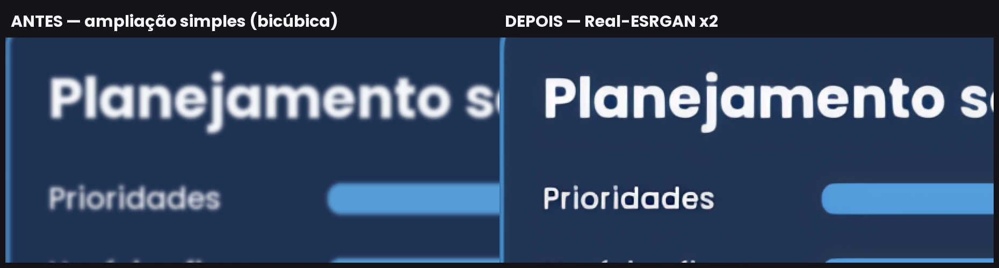

# Sistema inteligente de criação e edição audiovisual

**Inteligência artificial • Personalização • Automação de conteúdo**

Uma solução audiovisual orientada por instruções, concebida para transformar ideias e materiais brutos em conteúdos personalizados. Em vez de impor um modelo fixo de edição, o sistema parte do objetivo do usuário: o que criar, quais informações preservar, o que eliminar, qual estilo adotar e como entregar o resultado. A proposta abrange diferentes tipos de vídeo, imagem e conteúdo, independentemente do nicho.

## Fluxo proposto

1. Definir objetivo, materiais e instruções.
2. Criar ou transformar o conteúdo segundo os critérios escolhidos.
3. Entregar versões adequadas ao formato e à finalidade.

## Escopo da solução

### Criação a partir de uma ideia

Definir tema, roteiro, estrutura, textos, recursos visuais, música e formato para produzir um conteúdo do zero.

### Edição de materiais existentes

Cortar, reorganizar, combinar e adaptar vídeos, imagens e áudios conforme instruções específicas.

### Curadoria de conteúdo

Selecionar informações relevantes em aulas, reuniões, entrevistas ou treinamentos; remover assuntos, perguntas, pausas ou trechos definidos pelo usuário, preservando o contexto.

### Personalização audiovisual

Definir identidade visual, ritmo, transições, legendas, trilhas, enquadramento e tratamento de áudio e imagem.

### Distribuição e reaproveitamento

Transformar um material em versões completas, resumidas, cortes temáticos ou formatos horizontais e verticais para diferentes canais.

### Adaptação ao negócio

Configurar critérios de edição e produção de acordo com o nicho, público, finalidade e necessidades de cada equipe.

## Exemplos de aplicação

- **Educação:** Resumir uma aula mantendo os conceitos essenciais ou remover somente os assuntos solicitados.
- **Marketing:** Criar peças de campanha e adaptar um vídeo para diferentes canais e públicos.
- **Empresas:** Transformar treinamentos, apresentações e gravações internas em materiais objetivos.
- **Criadores de conteúdo:** Reaproveitar entrevistas, podcasts e vídeos longos em cortes temáticos com identidade própria.

## Valor para o negócio

Potencial de reduzir retrabalho, padronizar entregas e ampliar o reaproveitamento de materiais. Benefícios ainda não medidos em produção.

## Recursos demonstrados

Realce de imagem por IA, de 480 × 270 para 960 × 540.

Correção de cor com máscara; o teste ainda apresenta um halo discreto.

## Tecnologias e estágio do projeto

Claude Code, Python, FFmpeg, faster-whisper e Real-ESRGAN. Os testes existentes demonstram edição de aulas, cortes verticais, legendas, normalização de áudio e tratamento visual. Criação de novos vídeos e inclusão de trilhas são possibilidades da proposta, ainda sem demonstração publicada. Os vídeos de teste anteriores foram preservados no repositório, mas retirados da apresentação principal para futura substituição por materiais com narração mais natural.

[Voltar ao portfólio](../)
